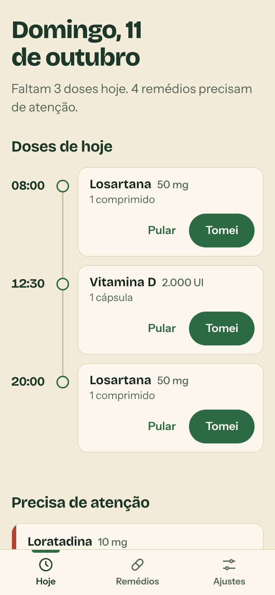
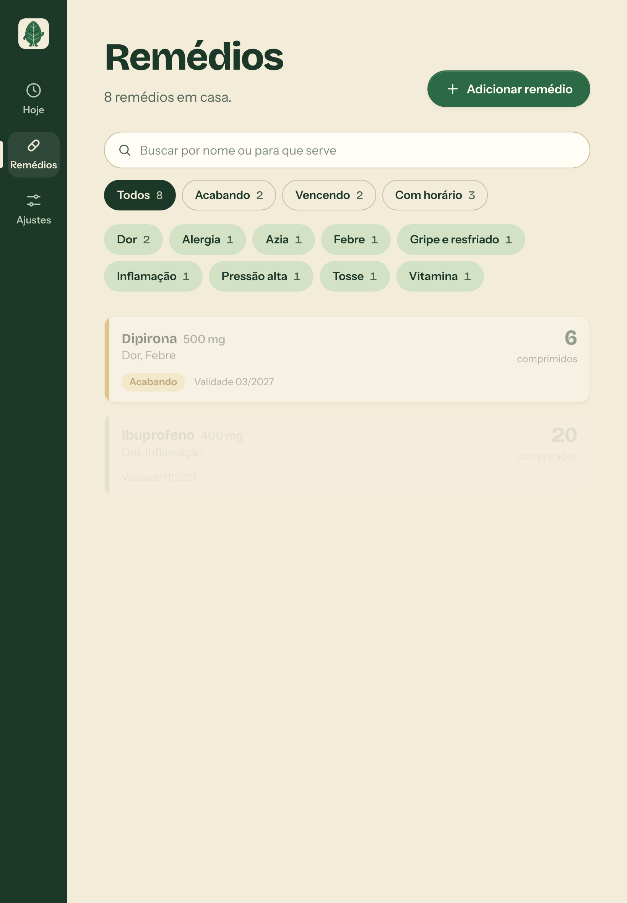
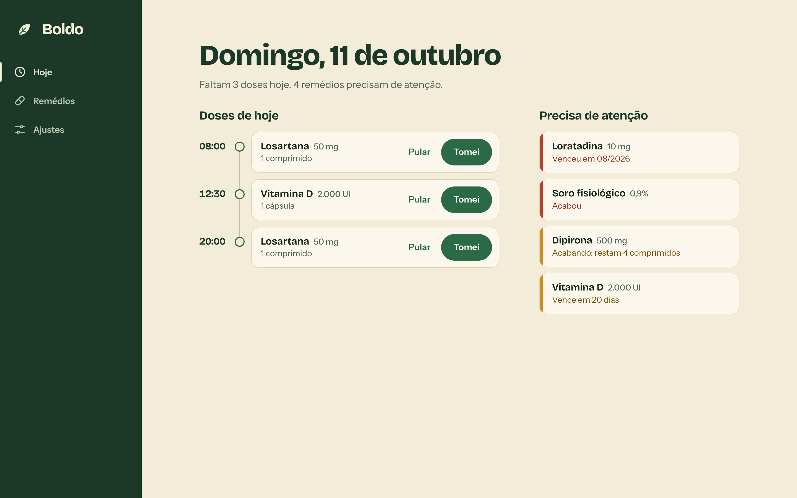
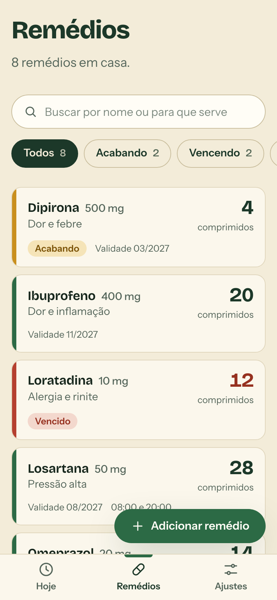
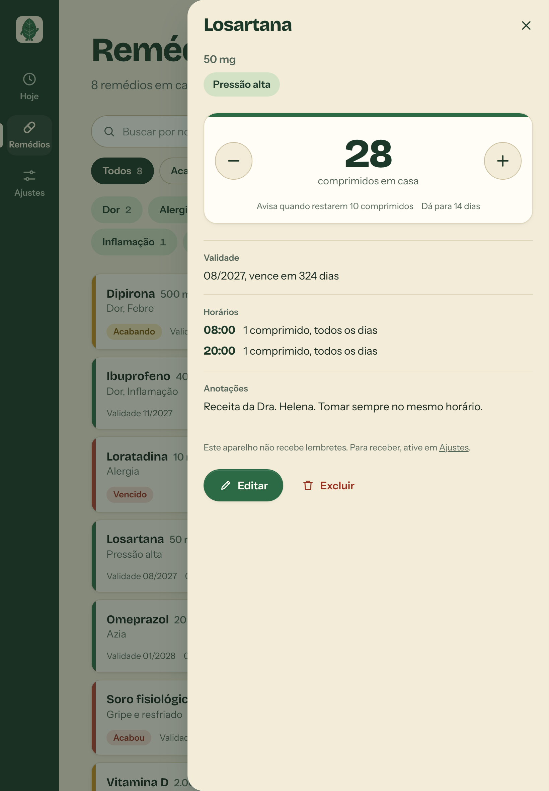
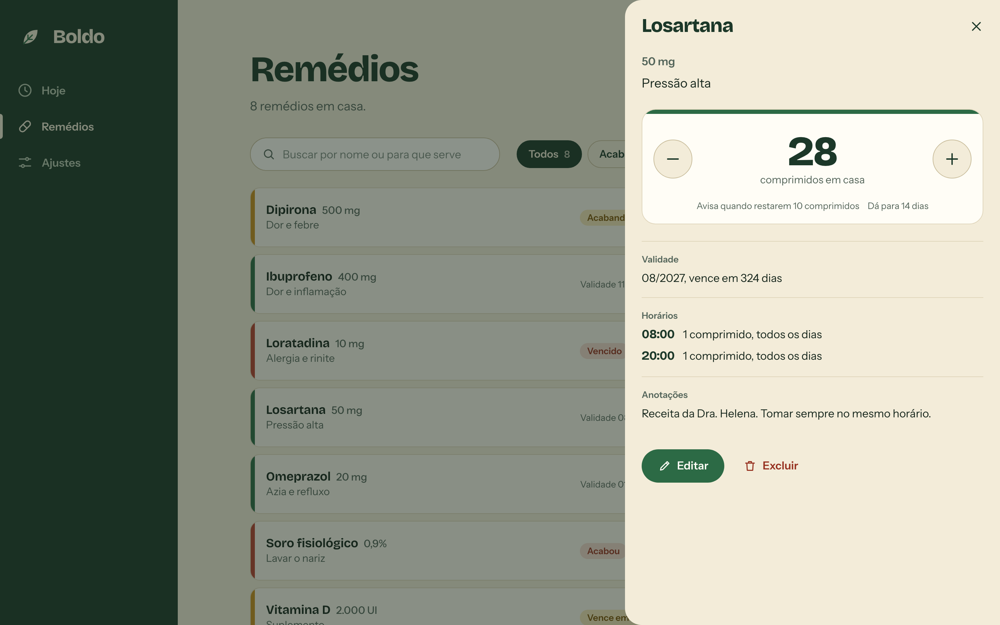

# Boldo


A farmacinha de casa: o que tem, quanto resta, para que serve e a hora de tomar.

Boldo é um app web instalável (PWA) para uma casa só. Os dados ficam em um banco na nuvem,
então o celular, o tablet e o computador mostram sempre a mesma farmacinha. O acesso é por
uma senha única, sem cadastro de usuários.

**No ar em https://ldallacqua.github.io/boldo/** (hospedagem gratuita: GitHub Pages +
Supabase; veja [docs/hospedagem.md](docs/hospedagem.md)).

| Celular                                                       | Tablet                                                      | Desktop                                                     |
| ------------------------------------------------------------- | ----------------------------------------------------------- | ----------------------------------------------------------- |
|          |  |        |
|  |    |  |

## O que ele faz

- **Remédios**: nome, dosagem (número e medida: mg, g, mcg, mL, UI, %…), para que serve
  (em tags: Dor, Febre, Alergia…, com filtro por tag na lista), quantidade, unidade
  (comprimidos, cápsulas, mL, gotas…), validade e anotações livres.
- **Código de barras**: ao cadastrar, aponte a câmera para o código da caixa (ou mande uma
  foto, ou digite os números) e o Boldo preenche nome, dosagem, unidade, quantidade da caixa e
  tags a partir da lista aberta de medicamentos da Anvisa. Você confere e salva.
- **Estoque**: botões de mais e menos para ajustar na hora. Quando há horários cadastrados,
  mostra para quantos dias o estoque dá.
- **Hoje**: as doses do dia em ordem de horário. "Tomei" registra a dose e já desconta do
  estoque; "Pular" e "Desfazer" também existem.
- **Lembretes por notificação**:
  - na hora de tomar cada dose (com botão "Tomei" na própria notificação, onde o sistema
    permite);
  - quando um remédio está acabando ou acabou;
  - quando a validade está chegando (30 dias antes, configurável) e quando vence.
- **Tarja de estado**: a faixa colorida de cada remédio resume a situação. Verde está em
  ordem, mostarda pede atenção (acabando ou vencendo), vermelha é acabou ou venceu.
- **Instalável** no celular, tablet e computador, e abre mesmo sem internet (os dados
  precisam de conexão).
- **Cópia dos dados** em JSON, em Ajustes.

## Onde ele roda

O Boldo tem duas formas de hospedagem, com o mesmo código:

|           | Hospedagem gratuita                       | Um servidor só                                     |
| --------- | ----------------------------------------- | -------------------------------------------------- |
| App       | GitHub Pages                              | o próprio servidor Node                            |
| API       | Edge Function do Supabase                 | o próprio servidor Node                            |
| Banco     | Postgres do Supabase                      | Postgres embutido (PGlite) em disco, ou um externo |
| Lembretes | cron do banco (`pg_cron`), a cada minuto  | o processo, a cada 30 s                            |
| Para quem | usar de qualquer lugar sem manter máquina | rodar em casa, com Docker                          |

### Hospedagem gratuita (é a que está no ar)

O passo a passo completo, incluindo como trocar a senha e republicar, está em
[docs/hospedagem.md](docs/hospedagem.md). Resumo: cada `git push` na `main` republica o app
no Pages; a API é publicada com `npm run deploy:api`.

### Um servidor só, com Docker

```bash
cp .env.example .env        # edite e troque ADMIN_PASSWORD
docker compose up -d --build
```

O app fica em `http://localhost:3210`. O banco mora no volume `boldo-data`.

### Um servidor só, com Node 24

```bash
npm ci
cp .env.example .env        # edite e troque ADMIN_PASSWORD
npm run build
npm start
```

### HTTPS é obrigatório fora do `localhost`

Os navegadores só deixam **instalar** o app e **receber notificações** em páginas HTTPS
(ou em `localhost`). O GitHub Pages já entrega HTTPS. No modo "um servidor só", publique
atrás de algo que faça isso: [Tailscale Serve](https://tailscale.com/kb/1312/serve),
[Cloudflare Tunnel](https://developers.cloudflare.com/cloudflare-one/connections/connect-networks/)
ou um proxy reverso como o Caddy. Atrás de proxy, defina `TRUST_PROXY=1`.

## Lembretes

1. Abra **Ajustes** e toque em **Ativar lembretes**. Faça isso em cada aparelho em que
   quiser ser avisado.
2. Use **Enviar um teste** para conferir.
3. Cadastre os **horários para tomar** em cada remédio. Sem horário, não há lembrete de dose.

Como funciona: o servidor confere o que está na hora (a cada minuto na hospedagem gratuita,
a cada 30 segundos no servidor próprio) e envia pelo padrão Web Push. Por isso os lembretes
chegam com o app fechado.

- **iPhone e iPad**: as notificações só funcionam com o app instalado (Compartilhar →
  "Adicionar à Tela de Início") e aberto por esse ícone. Exige iOS 16.4 ou mais novo.
- Os horários valem no fuso do servidor (`TZ`, padrão `America/Sao_Paulo`).
- Avisos de estoque e validade saem entre o horário configurado em Ajustes (padrão 09:00)
  e 21:00. Cada aviso sai uma vez; repor o estoque ou corrigir a validade rearma o aviso.
- Se o servidor estava fora do ar na hora da dose, o lembrete ainda sai se ele voltar em
  até uma hora.

## Configuração

No modo "um servidor só", tudo por variáveis de ambiente (veja [.env.example](.env.example)).
Na hospedagem gratuita, as mesmas ideias viram segredos do Supabase
([docs/hospedagem.md](docs/hospedagem.md)).

| Variável          | Padrão                  | Para que serve                                                           |
| ----------------- | ----------------------- | ------------------------------------------------------------------------ |
| `ADMIN_PASSWORD`  | (obrigatória)           | A senha única de acesso. Trocar a senha encerra todas as sessões.        |
| `PORT`            | `3210`                  | Porta HTTP.                                                              |
| `TZ`              | `America/Sao_Paulo`     | Fuso dos horários de dose e dos avisos.                                  |
| `DATA_DIR`        | `./data`                | Pasta do Postgres embutido.                                              |
| `DATABASE_URL`    | (vazio)                 | Se definido, usa esse Postgres em vez do embutido.                       |
| `ALLOWED_ORIGINS` | (vazio)                 | Origens que podem chamar a API quando o app é servido de outro endereço. |
| `VAPID_SUBJECT`   | endereço do repositório | Contato enviado aos serviços de push (URL `https:` ou `mailto:`).        |
| `TRUST_PROXY`     | `0`                     | `1` se houver proxy reverso enviando `X-Forwarded-For`.                  |

As chaves de push (VAPID) e os segredos de sessão são gerados na primeira execução e ficam
no banco. **Backup**: "Baixar cópia dos dados" em Ajustes gera um JSON com tudo.

## Desenvolvimento

```bash
npm ci
cp .env.example .env
npm run dev                 # API em :3210 e Vite em :5173 (abra o :5173)
```

Para ter dados de exemplo: `ADMIN_PASSWORD=<sua senha> node scripts/seed.mjs`.

O service worker (instalação, offline e notificações) só existe no build de produção:
use `npm run build && npm start` para testar essas partes.

| Comando            | O que faz                                                              |
| ------------------ | ---------------------------------------------------------------------- |
| `npm run dev`      | Servidor e front-end com recarga automática.                           |
| `npm run build`    | Gera `dist/` (app) e `dist-server/` (servidor).                        |
| `npm start`        | Roda o build de produção.                                              |
| `npm test`         | Testes unitários (Vitest).                                             |
| `npm run test:e2e` | Testes de ponta a ponta (Playwright) no Chromium e no WebKit (Safari). |
| `npm run check`    | Tipos, lint, formatação e testes unitários.                            |
| `npm run icons`    | Regenera os ícones do PWA.                                             |
| `npm run catalog`  | Baixa a lista da Anvisa e regenera o catálogo do código de barras.     |

Na primeira vez, instale os navegadores dos testes E2E: `npx playwright install chromium webkit`.

## Testes

- **Unitários** (`tests/unit`): regras de estoque e validade, datas e fusos, validação,
  banco de dados (em um Postgres embutido de verdade), API (sessão por token, limite de
  tentativas, CORS, cadastro, doses, cron), agendador de lembretes, criptografia do Web Push
  (conferida contra a biblioteca de referência `web-push`) e a lógica das notificações.
- **E2E** (`tests/e2e`): o app de produção em três tamanhos de tela, no Chromium e no WebKit
  (o motor do Safari do iPhone, do iPad e do Mac), mais um cenário que
  imita a hospedagem gratuita (app em subpasta de um site estático, API em outra origem).
  Cobre entrar e sair, cadastro completo, ajuste de estoque, edição com horários, exclusão,
  busca e filtros, doses do dia, manifesto e ícones do PWA, uso offline e a montagem da
  notificação no service worker.

O que os testes **não** cobrem: a entrega real do push pelo serviço do navegador (Google,
Apple, Mozilla) até um aparelho. Para isso, use "Enviar um teste" em Ajustes.

## Como é por dentro

```
shared/    Regras puras usadas pelo servidor e pelo app (estoque, validade, datas, validação)
server/    API (Hono), SQL (Postgres), Web Push e o agendador de lembretes
supabase/  Entrada da API como Edge Function (hospedagem gratuita)
src/       App React + service worker
art/       Artes originais do mascote
tests/     unit/ (Vitest) e e2e/ (Playwright)
scripts/   Ícones, empacotamento da Edge Function, dados de exemplo, capturas de tela
```

Detalhes de arquitetura, convenções e armadilhas estão em [AGENTS.md](AGENTS.md), escrito
para pessoas e para agentes de IA que forem mexer no código.

## O mascote

O Boldinho é uma folha de boldo. As artes em `art/mascote/` foram geradas por IA (gerador de
imagens do ChatGPT) a partir de um roteiro de personagem na paleta do app; `npm run icons`
transforma essas artes nos ícones do PWA e nas versões leves usadas nas telas.

## Licença

[MIT](LICENSE)
